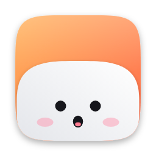

<div align="center">



# Coucou untuk Google Antigravity IDE

**Companion Notch desktop (Mochi) dan remote controller Android yang terintegrasi langsung dengan Google Antigravity IDE, Claude Code, dan berbagai AI coding agents secara real-time.**

Aplikasi ini menghadirkan interaksi AI agent langsung ke notch atas layar Windows dan ponsel Android: memantau aktivitas coding, menyetujui (approve/deny) izin tool eksekusi, merespons pertanyaan agent, melihat diff perubahan berkas, hingga mengirim prompt baru dari jarak jauh via Wi-Fi lokal maupun Cloudflare Tunnel publik.

<br>


</div>

---

## Fitur Utama

- **Integrasi Penuh Google Antigravity IDE**: Terhubung langsung ke runtime Antigravity IDE melalui Chrome DevTools Protocol (CDP) pada port 9334/9333 untuk membaca state, mendeteksi permission dialog, dan mengeksekusi prompt.
- **Antigravity Bridge Server**: Server jembatan berbasis Node.js (port 9335) yang menjembatani komunikasi antara Antigravity IDE, aplikasi desktop Coucou, dan aplikasi Android.
- **Dual Pairing QR Code (Lokal & Publik)**:
  - **Mode Lokal (Wi-Fi)**: Koneksi langsung berkecepatan tinggi via IP lokal (LAN) saat HP dan laptop berada di jaringan Wi-Fi yang sama.
  - **Mode Publik (Cloudflare Tunnel)**: Koneksi aman terenkripsi TLS melalui domain publik Cloudflare Tunnel (port 443), memungkinkan kontrol dan notifikasi dari luar rumah tanpa port-forwarding.
- **Persetujuan Izin Interaktif (Permission Approvals)**: Dialog konfirmasi izin (menjalankan perintah terminal, edit file, dll.) otomatis muncul di notch desktop dan ponsel Android dengan opsi Allow, Deny, atau Always.
- **Jendela Pengaturan Desktop Bergaya macOS**:
  - Tampilan sidebar modern berukuran 880x640 dengan navigasi kategori rapi:
    - HP Android & Pairing
    - Model & Provider AI (Antigravity IDE, Custom Server, Ollama, OpenAI)
    - Claude Code & Agen
    - Mochi & Integrasi (Stripe, GitHub, Vercel, dll.)
    - Pengaturan Umum (Bahasa, Suara, Autostart)
- **Aplikasi HP Android Companion**:
  - Live session monitor: Memantau langkah kerja agent secara berkala.
  - AI Chat & Prompting: Kirim instruksi baru langsung ke Antigravity IDE dari HP.
  - Live Diff Viewer: Menampilkan perubahan baris kode yang dibuat oleh agent.
  - Proteksi Keamanan: Opsi toggle keamanan tangkapan layar (screenshot prevention) yang dapat diaktifkan atau dinonaktifkan di pengaturan aplikasi.
- **Companion Notch Desktop (Mochi)**: Karakter interaktif di bilah atas layar yang responsif terhadap pergerakan mouse, status idle, dan notifikasi tugas agent selesai.

---

## Persyaratan Sistem

- **Sistem Operasi**: Windows 10 atau Windows 11 (64-bit)
- **Node.js**: Versi 18.x atau lebih baru
- **Google Antigravity IDE**: Terbuka dan aktif di laptop
- **Perangkat Android**: Android 11 atau lebih baru (untuk aplikasi Coucou Android)
- **Cloudflared (Opsional)**: Diperlukan jika ingin menggunakan mode pairing publik Cloudflare Tunnel

---

## Panduan Menjalankan

### 1. Menjalankan Antigravity Bridge Server

Bridge server bertugas menghubungkan Antigravity IDE ke Coucou Desktop dan HP Android.

1. Buka terminal PowerShell dan arahkan ke folder `windows/bridge`:
   ```powershell
   cd windows/bridge
   ```
2. Pasang dependensi jika belum terpasang:
   ```powershell
   npm install
   ```
3. Konfigurasi domain publik (opsional untuk Cloudflare Tunnel):
   Salin file contoh konfigurasi domain:
   ```powershell
   copy domain.example.txt domain.txt
   ```
   Buka file `domain.txt` dan isi dengan domain publik Anda, misalnya:
   ```text
   coucou.domainanda.com
   ```
4. Jalankan server bridge:
   ```powershell
   node server.js
   ```
   Atau cukup jalankan script batch:
   ```cmd
   start-bridge.bat
   ```
5. Server bridge akan aktif di `http://127.0.0.1:9335`.

### 2. Menguji Status Koneksi Bridge ke Antigravity IDE

Untuk memastikan Bridge telah tersambung dengan Google Antigravity IDE, jalankan:
```cmd
windows\test-bridge.bat
```
Output yang sukses akan menampilkan:
```text
Bridge Status: OK
Connected to Antigravity IDE: true
CDP Port: 9334
```

### 3. Menjalankan Aplikasi Desktop Coucou

1. Jalankan aplikasi melalui script:
   ```cmd
   windows\run-coucou.bat
   ```
   Atau jalankan file binary `coucou.exe` yang sudah terpasang di komputer Anda.
2. Karakter Mochi akan muncul di bilah atas (notch) layar Windows Anda.

### 4. Menghubungkan HP Android (Pairing)

1. Pasang file `coucou.apk` di ponsel Android Anda.
2. Buka jendela **Pengaturan Coucou** di desktop (klik kanan icon Coucou di tray atau klik icon gear di notch).
3. Pilih menu **HP Android & Pairing** pada sidebar kiri.
4. Aktifkan switch **Phone link**.
5. Klik tombol **Show pairing code**:
   - Jika HP dan PC berada di Wi-Fi yang sama, pilih tab **[ Lokal (Wi-Fi) ]**.
   - Jika ingin terhubung dari luar rumah melalui internet, pilih tab **[ Publik (Cloudflare) ]**.
6. Buka aplikasi Coucou di HP Android, pilih menu scan QR, lalu arahkan kamera ke kode QR di layar desktop.
7. HP Android akan terhubung secara otomatis dan siap menerima status serta konfirmasi perintah dari Antigravity IDE.

### 5. Menjalankan Cloudflare Tunnel (Akses Luar Jaringan)

Jika Anda ingin mengakses Antigravity IDE dari luar jaringan rumah:
1. Unduh executable `cloudflared.exe` dari Cloudflare.
2. Jalankan tunnel yang mengarah ke port lokal bridge:
   ```powershell
   cloudflared.exe tunnel run --token <TOKEN_TUNNEL_ANDA>
   ```
3. Pastikan konfigurasi public hostname di Cloudflare dashboard mengarah ke `http://localhost:9335`.

---

## Struktur Repositori

```text
coucou/
├── .github/workflows/       # Workflow otomatis build CI/CD GitHub Actions
│   └── windows.yml          # Otomasi compile installer Windows (.exe / .msi)
├── android/                 # Source code aplikasi Android (Kotlin / Jetpack Compose)
│   └── app/src/main/java/   # Logika client, link pairing, dan interface
├── windows/                 # Source code aplikasi Desktop Windows
│   ├── bridge/              # Antigravity Bridge Server (Node.js & CDP Controller)
│   │   ├── server.js        # Server API dan WebSocket relay
│   │   ├── cdp_controller.js# Pengendali Chrome DevTools Protocol untuk Antigravity IDE
│   │   ├── domain.txt       # Konfigurasi domain publik Cloudflare
│   │   └── uploads/         # Berkas installer APK dan media
│   ├── src/                 # Kode frontend UI Settings & Notch (TypeScript / CSS)
│   │   ├── settings/        # Halaman pengaturan modern dengan Sidebar macOS
│   │   │   ├── main.ts      # Logika sidebar kategori dan navigasi
│   │   │   ├── phone.ts     # Logika dual QR code pairing (Wi-Fi & Cloudflare)
│   │   └── settings.css     # Styling tema gelap glassmorphism
│   ├── src-tauri/           # Backend aplikasi native Windows (Rust & Tauri v2)
│   │   └── src/lib.rs       # Inisialisasi jendela desktop, dimensi, dan event
│   ├── run-coucou.bat       # Launcher cepat untuk Bridge & Aplikasi Desktop
│   ├── start-bridge.bat     # Script menjalankan Node.js Bridge Server
│   └── test-bridge.bat      # Script diagnostik pengujian koneksi CDP IDE
└── README.md                # Dokumentasi utama project
```

---

## Lisensi

Proyek ini berbasis pada Coucou oleh Louis Raille dengan modifikasi khusus untuk integrasi Google Antigravity IDE, Cloudflare Tunnel remote link, dan perombakan antarmuka Windows desktop. Berlisensi di bawah **MIT License**.
